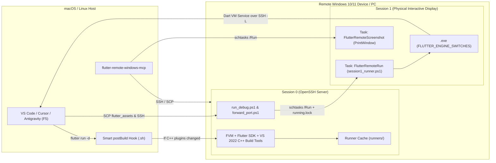

# flutter-remote-windows-mcp

[](https://github.com/brktlhylmz/flutter-remote-windows-mcp/actions/workflows/ci.yml)
[](LICENSE)
[](https://dart.dev)
[](https://modelcontextprotocol.io)

A zero-dependency **Model Context Protocol (MCP)** server written in pure Dart that automates wireless **Flutter Windows Desktop** development, `flutter custom-devices` provisioning, native C++ runner building, and live **Interactive Session 1 GUI debugging** (with sub-second **Hot Reload** and **VS Code `F5` debugging**) directly from **macOS or Linux** onto any remote Windows 10/11 machine, laptop, or cloud VM.

---

## Why Does This Exist?

Flutter does not support cross-compiling Windows desktop executables (`.exe` + Win32/DirectX C++ plugins) directly on macOS or Linux. While Flutter provides an experimental `custom-devices` mechanism, wiring it up to a real Windows 11 device over Wi-Fi/SSH hits six major Windows-specific roadblocks that this MCP server solves automatically:

1. **Passwordless SSH on Windows Hello / Microsoft Account Machines (`generate_ssh_pairing`)**
   - Windows 11 machines signed in with a Microsoft Account + PIN often reject standard SSH password authentication.
   - OpenSSH on Windows requires `C:\ProgramData\ssh\administrators_authorized_keys` to have strict ACL permissions for `Administrators` and `SYSTEM`. Using localized group names (`icacls ... /grant "Administrators:F"`) fails on non-English Windows installations.
   - **Solution:** Spins up a temporary local HTTP pairing server and gives you a single 1-line PowerShell command (`irm http://<HOST_IP>:8765 | iex`) that installs OpenSSH Server, registers your `id_ed25519.pub` key, and applies **locale-independent security identifiers** (`*S-1-5-32-544:F` and `*S-1-5-18:F`).

2. **Windows `Session 0` Isolation vs. `Session 1` Physical Display (`setup_flutter_custom_device`)**
   - Processes launched over SSH on Windows run inside **Session 0** (a headless, non-interactive service session). Starting a Flutter Windows GUI app directly over SSH results in an invisible process with no window on the physical screen.
   - **Solution:** Automatically provisions a Windows Scheduled Task (`FlutterRemoteRun` with `/IT` interactive token) that bridges SSH (`Session 0`) to the logged-in user's physical desktop (`Session 1`), streaming `stdout` and `stderr` back to your macOS/Linux terminal in real time.

3. **Task Scheduler Job Object Lifetime (`running.lock` synchronization)**
   - Windows Task Scheduler wraps every task in a Win32 Job Object that immediately kills all child processes (`<app>.exe`) when the task's wrapper script exits. Furthermore, Session 1 scripts cannot query Session 0 SSH PIDs due to cross-session access denial.
   - **Solution:** Coordinates process lifetime across sessions using a lockfile (`running.lock`) so the Flutter window stays alive on the physical display until you stop debugging in VS Code or press `q` in the terminal.

4. **`flutter_windows.dll` Engine Switches (`FLUTTER_ENGINE_SWITCHES`)**
   - Unlike Linux embedders, the Windows Flutter engine (`flutter_windows.dll`) ignores command-line `--enable-dart-profiling` flags passed by `flutter custom-devices`. Instead, its C++ `ParseFlutterEngineSwitches()` function reads environment variables (`FLUTTER_ENGINE_SWITCHES=<N>`, `FLUTTER_ENGINE_SWITCH_1=...`).
   - **Solution:** Automatically translates `${engineOptions}` into `FLUTTER_ENGINE_SWITCH_*` environment variables inside `Session 1` before launching the executable, allowing the Dart VM Service (`http://127.0.0.1:<port>`) to start and connect over SSH port forwarding.

5. **Smart `postBuild` Hook & Multi-Project Isolation**
   - Normally, `flutter custom-devices` only pushes `build/flutter_assets` (Dart kernel + assets) to the remote device. If you add a new native Windows C++ plugin to `pubspec.yaml` or switch to another Flutter project, the remote Windows `.exe` runner would be missing or outdated.
   - **Solution:** Installs a smart `~/.config/flutter/post_build_<device_id>.sh` hook that fingerprints `windows/`, `.flutter-plugins-dependencies`, and the active Flutter Engine revision on every `F5` / `flutter run`. If native changes are detected (or if this project has never been built on the remote machine), it automatically syncs and compiles the Windows C++ runner into an isolated cache (`C:\Users\<user>\flutter_remote\runners\<appName>`) before launching.

6. **Privacy-Safe, Window-Only Screenshots (`take_remote_screenshot`)**
   - Full-screen desktop capture on a remote machine is a privacy hazard if the app is closed or personal windows/notifications are open.
   - **Solution:** Uses Win32 `PrintWindow(..., PW_RENDERFULLCONTENT)` and `DwmGetWindowAttribute(DWMWA_EXTENDED_FRAME_BOUNDS)` inside `Session 1` to capture **only** the running Flutter application's window surface—excluding the Windows taskbar, system tray, notifications, and desktop background. If the target Flutter app is not running or is minimized, capture is **blocked (fail-closed)**.

---

## Architecture



---

## Installation

### Prerequisites (Host: macOS / Linux)
- **Dart SDK** `>=3.5.0` (bundled with Flutter)
- **Flutter SDK** installed on your host machine
- OpenSSH client (`ssh` and `scp`, pre-installed on macOS/Linux)

### 1. Activate Globally from GitHub (or Local Clone)

```bash
# Install directly from GitHub:
dart pub global activate --source git https://github.com/brktlhylmz/flutter-remote-windows-mcp.git

# Or clone locally and activate:
git clone https://github.com/brktlhylmz/flutter-remote-windows-mcp.git
cd flutter-remote-windows-mcp
dart pub get
dart pub global activate --source path .
```

### 2. Add to Your MCP Client Configuration

#### Antigravity / Claude Desktop / Cursor / Windsurf (`mcp_config.json`)

Add the following entry under `"mcpServers"`:

```json
{
  "mcpServers": {
    "flutter-remote-windows": {
      "command": "dart",
      "args": [
        "pub",
        "global",
        "run",
        "flutter_remote_windows_mcp:flutter-remote-windows-mcp"
      ]
    }
  }
}
```

---

## Step-by-Step Quickstart

Once the MCP server is connected to your AI coding assistant, you can set up a brand-new Windows device in 4 steps:

1. **Pair SSH Passwordlessly (`generate_ssh_pairing`)**
   - Ask your agent: *"Generate an SSH pairing command for my Windows device."*
   - Run the returned 1-line `irm http://<HOST_IP>:8765 | iex` command in **Administrator PowerShell** on your Windows device.
2. **Install or Verify the Windows Toolchain (`check_remote_windows` & `install_windows_toolchain`)**
   - Ask your agent: *"Check my Windows device at `192.168.1.50` (user `devuser`) and install FVM, Sidekick, Flutter, and Visual Studio Build Tools if missing."*
3. **Register the Wireless Custom Device (`setup_flutter_custom_device`)**
   - Ask your agent: *"Set up my Windows device `192.168.1.50` as a Flutter custom device named `windows-pc` for my project."*
4. **Press `F5` in VS Code (or run `flutter run -d windows-pc`)!**
   - The smart `postBuild` hook will build the Windows C++ runner on the first run and cache it. Subsequent runs and **Hot Reloads (`r`)** take less than a second!

---

## Available MCP Tools (12 Tools)

| # | Tool Name | Description |
|---|-----------|-------------|
| 1 | `manage_device_profiles` | Lists, saves, removes, or sets the default Windows device profile in `~/.config/flutter_remote_windows/config.json` (supports custom `ssh_port`, `use_tcp_ping` for firewalled VMs, and `keep_headless_session_alive` for RDP/headless machines). Once saved, other tools automatically resolve `host`, `user`, and `ssh_port` from the profile! |
| 2 | `generate_ssh_pairing` | Starts a temporary HTTP pairing server on the host and outputs a 1-line Administrator PowerShell command (`irm http://<IP>:8765 \| iex`) plus a standalone script for remote/WAN VMs to enable OpenSSH Server with locale-independent SID ACLs (`*S-1-5-32-544:F`). |
| 3 | `check_remote_windows` | Inspects the remote Windows device over SSH: OS version, hostname, free disk space, Git, FVM, Sidekick, Flutter SDK version, and Visual Studio 2022 C++ Build Tools (`VCTools`). |
| 4 | `install_windows_toolchain` | Remotely installs **FVM**, **Sidekick** (with a Desktop shortcut), **Flutter SDK**, and **Microsoft Visual Studio 2022 Build Tools (`VCTools`)** via SSH. |
| 5 | `sync_flutter_version` | Compares the host's active Flutter version (or `.fvmrc`) with the remote Windows device and uses FVM on Windows to install/activate the exact same version so Dart VM `kernel_blob.bin` snapshots always match. |
| 6 | `setup_flutter_custom_device` | Saves the profile to `config.json`, configures `~/.config/flutter/custom_devices.json` (with TCP ping `nc -z` and custom `ssh_port`), `~/.ssh/config`, `.vscode/launch.json`, the smart `postBuild` auto-rebuild hook, and deploys the `Session 1` Task Scheduler scripts (`FlutterRemoteRun` & `FlutterRemoteScreenshot`). |
| 7 | `sync_and_rebuild_windows_runner` | Syncs the local Flutter project to an isolated folder (`projects/<appName>`) on the Windows device, runs `flutter build windows --debug`, and updates the cached runner (`runners/<appName>`). |
| 8 | `take_remote_screenshot` | **Privacy-safe window-only screenshot:** Captures **only** the running Flutter application window (`PrintWindow` + `DWMWA_EXTENDED_FRAME_BOUNDS`) in `Session 1` and downloads the PNG to the host. Fails closed (`ERR_NO_APP` / `ERR_MINIMIZED`) if the app is not running. |
| 9 | `set_dev_power_mode` | Toggles `keep_awake` (disables display & Modern Standby sleep timeouts on AC/battery during wireless debugging) or `restore_default` (15m/30m timeouts). |
| 10 | `discover_and_update_ip` | Automatically discovers the Windows device's new IP address on the local Wi-Fi network (via mDNS `.local` or ARP/SSH scan) and updates `config.json`, `~/.ssh/config`, `custom_devices.json`, and the `postBuild` script. |
| 11 | `build_and_fetch_release` | Syncs the project, runs `flutter build windows --release` on the remote Windows machine, packages the release output into `<appName>-windows-release.zip`, and downloads it to your local `build/` directory. |
| 12 | `remote_app_control` | Controls and diagnoses the remote app: `status` (check Session 1 process), `logs` (read `stdout`/`stderr`), `stop` (terminate app), `launch_test` (test Session 1 launch), or `update_ip`. |

---

## Multi-Device & Remote Office PC / Cloud VM Configuration (`config.json`)

Device profiles are automatically stored in `~/.config/flutter_remote_windows/config.json`:

```json
{
  "default_device": "windows-pc",
  "devices": {
    "windows-pc": {
      "device_id": "windows-pc",
      "label": "Remote Windows PC (Wireless)",
      "host": "192.168.1.50",
      "user": "devuser",
      "ssh_port": 22,
      "use_tcp_ping": true,
      "keep_headless_session_alive": false,
      "default_app_name": "my_flutter_app"
    },
    "office-pc": {
      "device_id": "office-pc",
      "label": "Office Windows PC (Tailscale / Remote)",
      "host": "100.84.10.25",
      "user": "devuser",
      "ssh_port": 2222,
      "use_tcp_ping": true,
      "keep_headless_session_alive": true,
      "default_app_name": "my_flutter_app"
    }
  }
}
```

- **`use_tcp_ping: true`**: Uses `nc -z <host> <ssh_port>` instead of ICMP `ping` so cloud VMs (AWS/Azure/GCP) and office networks that block ICMP echo requests still show as online in `flutter devices`.
- **`keep_headless_session_alive: true`**: Automatically runs `tscon.exe <SessionId> /dest:console` if an RDP session was disconnected (`Disc`), keeping the GPU and `Session 1` surface active on headless VMs and office PCs.

---

## Development & Testing

```bash
# Install dependencies
dart pub get

# Check code formatting
dart format --output=none --set-exit-if-changed .

# Run static analysis
dart analyze --fatal-infos

# Run unit tests
dart test
```

## Contributing

Contributions, issues, and feature requests are welcome! Please see [CONTRIBUTING.md](CONTRIBUTING.md) for guidelines.

## License

This project is licensed under the **MIT License** — see the [LICENSE](LICENSE) file for details.
